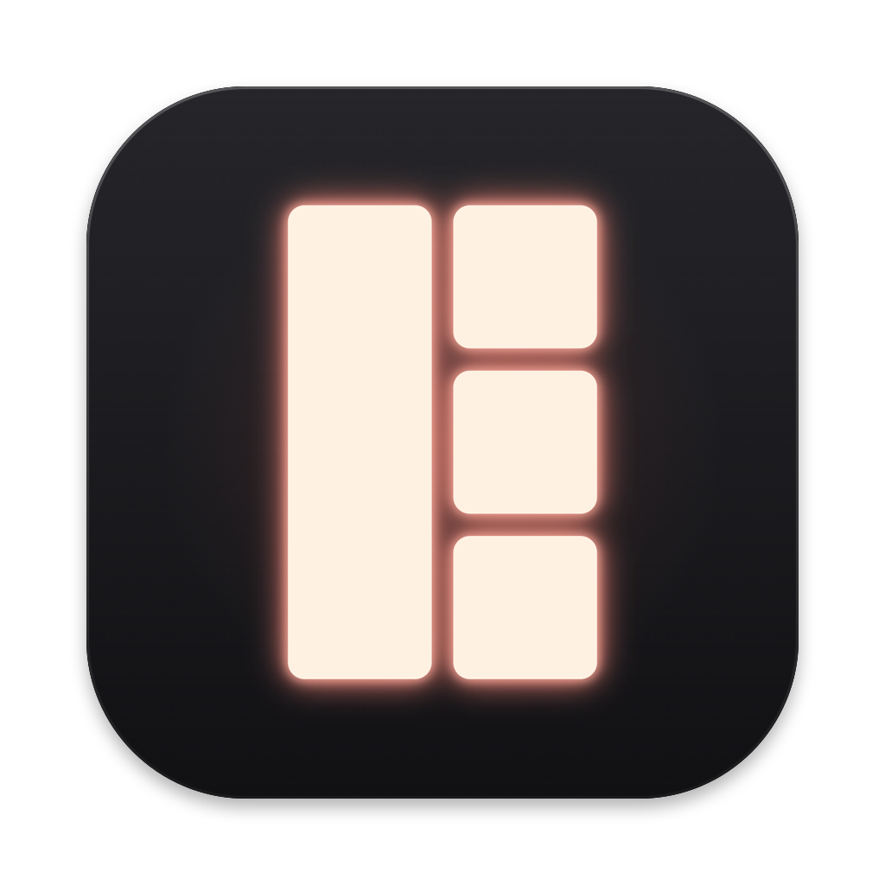

# Ember

A Dynamic Island for the MacBook notch. Ember is a black pill that sits around the
notch, glows when something is happening, and expands into media controls, live
activities and quick tools.

> **Status: early development.** There is nothing to install yet.

## Planned for the first release

- Now Playing: artwork, playback controls and scrubber
- Live activities: battery and charging, Bluetooth devices
- Timers
- Calendar and reminders preview
- File shelf: drop files on the notch
- Auto-updates

The full list, including what comes later, is in [docs/features.md](docs/features.md).

## Requirements

- A MacBook with a notch
- macOS 15 (Sequoia) or later

## Install

Not released yet. Ember will be a free download from GitHub Releases. It will not be
notarized by Apple, so macOS will show a warning the first time you open it; the steps
to get past that will be documented here.

## Building from source

You need a Mac with Xcode 27 or later.

1. Clone this repository.
2. Open `Ember.xcodeproj` in Xcode.
3. Press Run (⌘R).

## Credits

Ember builds on the work of two open-source projects, both licensed under GPL-3.0:

- [Atoll](https://github.com/Ebullioscopic/Atoll) © Atoll Contributors
- [Boring Notch](https://github.com/TheBoredTeam/boring.notch) © TheBoredTeam

Ember is a modified work: parts of its code are derived from these projects. Their
names, logos and assets are not used.

## Built with AI

Ember is built with [Claude Code](https://claude.com/claude-code). The planning
documents are in [docs/](docs/): vision, roadmap, feature list and a log of decisions.

## License

Ember is licensed under the [GNU General Public License v3.0](LICENSE).
