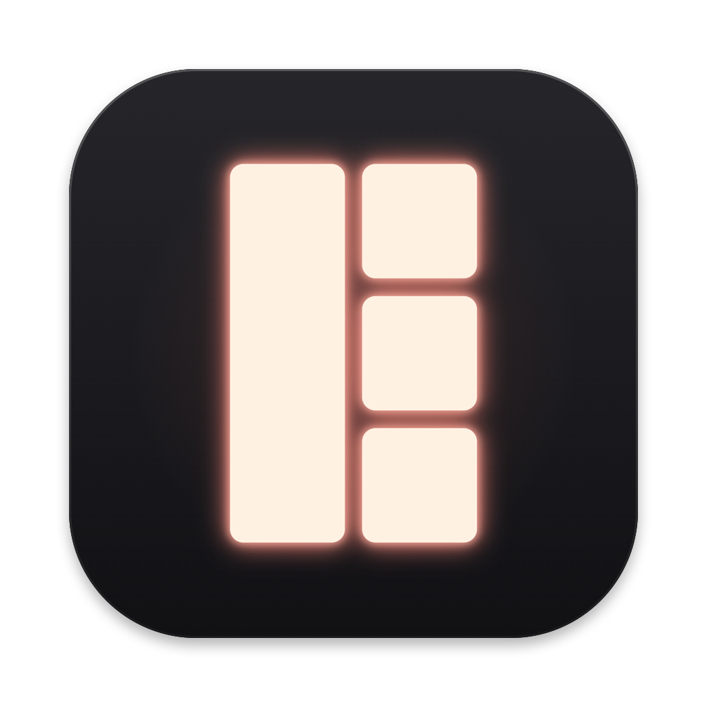

<div align="center">



<h1>Ember</h1>

<p>
A Dynamic Island for the MacBook notch. Ember is a black pill that sits around the
notch, glows when something is happening, and expands into media controls, live
activities and quick tools.
</p>

<p>
<a href="https://github.com/shajiyev/Ember_Dynamic_Island/releases/latest"><strong>Download Ember</strong></a>
· free and open source · macOS 15 or later
</p>

</div>

## What it does

- **Now Playing** for Apple Music and Spotify: the cover and a bouncing equalizer beside
  the notch, glowing in the cover's colour. Hover to open the panel with the song, a
  scrubber and the buttons you choose (previous, next, shuffle, repeat, back or forward
  10 seconds). When the song changes, its name shows for a moment below the notch.
- **Live activities** in the notch: a timer counting down, the charger plugged in or out,
  a low battery, a heads-up before your next event.
- **Volume and brightness** in the pill, instead of macOS's own indicator.
- **Calendar**: the month, with your day's events and reminders beside it if you want
  them; tick reminders off right there.
- **File shelf**: drag files onto the notch to keep them at hand, then drag them out again,
  AirDrop them, or preview them with Space. New screenshots can land there too.
- **Keep awake**: keep your Mac from sleeping for a while, even with the lid closed.
- **Make it yours**: the glow's colour and strength, each feature's colour, the panel's
  layout and width, which tabs show and where, a keyboard shortcut to open the panel.
- **Private**: hidden in screenshots and screen sharing, and, if you like, in full-screen
  apps.
- **Updates**: Ember checks for new versions once a day (if you allow it) and nothing
  installs without your click.

The full list, including what comes later, is in [docs/features.md](docs/features.md).

## Requirements

- A MacBook with a notch: a 14- or 16-inch MacBook Pro (2021 and later) or a MacBook Air
  with M2 or later
- macOS 15 (Sequoia) or later

## Install

1. Download `Ember-<version>.dmg` from the
   [latest release](https://github.com/shajiyev/Ember_Dynamic_Island/releases/latest).
2. Open it and drag **Ember** onto **Applications**.
3. Open Ember from Applications. macOS says **"Ember" Not Opened**. Click **Done** (not
   Move to Trash).
4. Open **System Settings → Privacy & Security**, scroll down to **Security**, and next to
   "Ember" was blocked… click **Open Anyway**. Confirm with your password or Touch ID,
   then click **Open Anyway** once more.

You do this once. Updates install without it.

**Why the warning?** Ember is free, and Apple asks $99 a year to check ("notarize") an app,
so Ember is not notarized. macOS warns about every app it has not checked. Ember's code is
all here to read, and every update is signed, so Ember only installs updates that come
from its author.

<details>
<summary>Prefer the Terminal?</summary>

Instead of steps 3 and 4, this removes the "downloaded from the internet" mark macOS checks:

```
xattr -dr com.apple.quarantine /Applications/Ember.app
```
</details>

## The first launch

Ember says hello in the notch, then asks a few short questions: the glow, and each feature
that needs a permission. Nothing that needs a permission is switched on before you say so.

Ember lives in the menu bar (the E icon) and in the notch: hover the notch to open the
panel, and use the gear at its top right or the menu bar icon for Settings.

**Can't see the menu bar icon?** Menu bar managers such as Hidden Bar, Bartender or Ice
may hide new icons; reveal it there. Without the icon, opening Ember again (from
Applications or Spotlight) opens its Settings.

## Permissions

Each one belongs to a feature you turn on, during the first launch or later in Settings.

- **Automation (Music, Spotify):** for Now Playing. The first time Ember shows what is
  playing, macOS asks whether Ember may control Music and Spotify. Ember uses this only to
  read the current song and to play, pause, skip and seek. You can change it later in
  System Settings → Privacy & Security → Automation.
- **Calendars:** only if you turn on Show Calendar Events in Ember's Settings (Calendar). Ember reads your
  events to show them beside the month and to give you a heads-up before each one.
  It never changes your events. Without it, the Calendar tab still shows the month.
- **Reminders:** only if you turn on Show Reminders. Ember reads reminders that are due and
  marks one completed when you tick it off (or not completed, when you untick it). It also
  reads the reminders completed that day, to list them at the end.
- **Accessibility:** for Show volume in the pill and Show brightness in the pill. Ember uses
  it to take the volume and mute keys, or the brightness keys, before macOS does, so the
  level shows in the pill instead of macOS's own indicator. Every other key goes on to
  macOS untouched. Without it, the keys work as usual. You can change it in System Settings
  → Privacy & Security → Accessibility.
- **Your admin password:** only when Keep awake starts or stops with Also with the lid
  closed. macOS asks for it in its own dialog; Ember never sees it. It lets Ember run
  `pmset -a disablesleep`, the only switch that keeps a Mac awake with the lid closed, and
  start a small watcher that switches sleep back on by itself at the end, at 10% battery,
  or when Ember quits. Keep awake with the lid open needs no permission. **Allow Without
  Password** (Settings → Keep Awake) asks once and installs a rule in
  `/etc/sudoers.d/ember-keep-awake` that lets your account run only those two `pmset`
  commands without a password; **Remove** deletes it.

## Privacy

Nothing leaves your Mac except the daily update check (which sends nothing about your Mac)
and, while Spotify plays, the download of the song's cover from Spotify. Ember has no
accounts, no analytics and no tracking.

## Tips

- **Dropping files on the notch opens Mission Control?** macOS opens Mission Control when
  something is held against the top of the screen. To use the file shelf without it, turn
  off System Settings → Desktop & Dock → Mission Control → "Drag windows to top of screen
  to enter Mission Control". Ember's Settings → Shelf has a button that opens that page.

## Uninstall

1. If you used Keep awake's **Allow Without Password**, press **Remove** in Settings → Keep
   Awake first.
2. Quit Ember (menu bar icon → Quit) and move it from Applications to the Trash.
3. To forget its settings too: `defaults delete io.github.shajiyev.Ember`

## Bugs and ideas

Use **Share Feedback** in Ember's menu: it opens an email to
[ember.share.feedback@gmail.com](mailto:ember.share.feedback@gmail.com) with your Ember and
macOS versions already in it. You can also open an
[issue on GitHub](https://github.com/shajiyev/Ember_Dynamic_Island/issues).

## Built with AI

Ember is built with [Claude Code](https://claude.com/claude-code). The documents about the logic of development
are in [docs/](docs/): plans, specs, architecture, vision, roadmap, feature list and a log of decisions.

## For developers: building from source

This is only for developers who want to compile Ember themselves. **You don't need it to
use Ember:** download it above, and that is all.

To build it, you need a Mac with Xcode 27 or later.

1. Clone this repository.
2. Once per Mac, from the repository folder, run `scripts/make-signing-certificate.sh`. It
   adds a self-signed certificate, "Ember Code Signing", to your login keychain, and Xcode
   signs Ember with it. Every build then has the same signature, so permissions such as
   Accessibility stay granted across rebuilds. The first build may ask whether codesign may
   use the key: enter your Mac password and click Always Allow.
3. Open `Ember.xcodeproj` in Xcode. It fetches Sparkle, the only package Ember uses.
4. Press Run (⌘R).

## License

Ember is licensed under the [GNU General Public License v3.0](LICENSE). Small portions of
code are adapted from [Atoll](https://github.com/Ebullioscopic/Atoll) and
[Boring Notch](https://github.com/TheBoredTeam/boring.notch) (GPL-3.0). Auto-updates use
[Sparkle](https://sparkle-project.org) (MIT). The two album covers in the website's demo
(`site/assets/covers/`) belong to their owners and are not covered by this licence.
